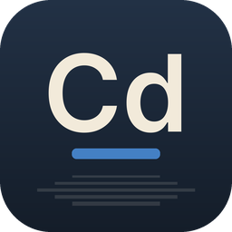

<p align="center">
  
</p>

<h1 align="center">CAD · Suíte FisiLab</h1>

<p align="center">
  <b>Desenho técnico e CAD</b><br>
  Alternativa livre ao <b>Autodesk AutoCAD</b>
</p>

<p align="center">
  Disponibilizado pelo <b>FisiLab — LARFIC · UFRGS</b> em parceria com o <b>CTA — Centro de
  Tecnologia Acadêmica</b>, para democratizar o acesso à tecnologia entre os alunos da UFRGS.
</p>

---

O CAD faz parte da [Suíte FisiLab](https://github.com/mrcandrade/larfic/tree/main/suite-fisilab):
programas livres para ensino, pesquisa e criação. Ele é uma versão modificada do
[CADCraft](https://github.com/storytold/cadcraft), uma reimplementação aberta e escrita em Rust do
fluxo de trabalho do AutoCAD.

## O que faz

- **O fluxo de trabalho que você já conhece:** linha de comando com prompts e `[palavras-chave]`
  clicáveis, autocompletar, apelidos (`L`, `C`, `@5<45`), referência a objetos (snaps), rastreamento
  polar, ortogonal, seleção por janela e por cruzamento e grips.
- **Desenho e modificação:** LINE, PLINE, CIRCLE, ARC, RECTANG, POLYGON, ELLIPSE, SPLINE, TEXT,
  MTEXT; MOVE, COPY, ROTATE, SCALE, MIRROR, OFFSET, TRIM, EXTEND, FILLET, CHAMFER, ARRAY e mais.
- **Camadas e propriedades:** paleta de camadas e gerenciador de propriedades de camadas, tipos e
  espessuras de linha, cores indexadas e true color, paleta de propriedades por objeto.
- **Anotação:** todas as cotas DIM* com estilos de cota, cotas associativas, MLEADER, TABLE,
  fontes TrueType e hachuras (por ponto interno, com ilhas, sólidas e em gradiente).
- **Blocos, layouts e plotagem:** BLOCK/INSERT com atributos, espaço de papel com viewports,
  configurações de página, PLOT e exportação para PDF, SVG e PNG.
- **Arquivos DXF e DWG:** DXF lido (R12–2018, ASCII e binário) e gravado nativamente; DWG aberto e
  salvo por meio da biblioteca livre acadrust.
- **Paramétrico:** restrições geométricas e dimensionais, AUTOCONSTRAIN e PARAMETERS com
  expressões.
- **Automação:** servidor MCP, canal de controle JSON e a ferramenta de linha de comando
  `fisilab-cad-cli` (informações, conversão, scripts, exportação).

## Instalação

### Windows

Baixe o instalador `FisiLab-CAD-Setup-<versão>.exe` na [página de downloads da Suíte FisiLab](https://github.com/mrcandrade/larfic/releases/latest) e execute-o. O CAD abre em português do Brasil na primeira execução, com a paleta original no tema
**Noite**; o idioma e o tema (**Dia** ou o do sistema) podem ser trocados no menu e nas Opções.

### Compilar a partir do código

É preciso ter o [Rust](https://rustup.rs) 1.95 ou mais recente.

```sh
git clone https://github.com/mrcandrade/fisilab-cad
cd fisilab-cad
cargo run --release -p cadcraft -- --sample   # abre o CAD com um desenho de exemplo
cargo build --release -p cadcraft -p cadcraft-cli
```

Os executáveis ficam em `target/release/fisilab-cad` (programa) e `target/release/fisilab-cad-cli`
(linha de comando). Os pacotes Rust mantêm os nomes originais (`cadcraft`, `cadcraft-cli`, ...).

## Créditos

O CAD é baseado no [CADCraft](https://github.com/storytold/cadcraft), criado pela equipe
ArtCraft e pelos contribuidores do CADCraft. O código é distribuído sob a licença MIT ou a
Apache-2.0, à sua escolha ([LICENSE-MIT](LICENSE-MIT), [LICENSE-APACHE](LICENSE-APACHE)). Veja
[NOTICE](NOTICE), [ATTRIBUTION.md](ATTRIBUTION.md), [MODIFICACOES.md](MODIFICACOES.md) (o que mudou
nesta versão) e o [README original](README.upstream.md).

Os nomes e as marcas do projeto original pertencem aos seus donos. Esta versão não é afiliada ao
projeto original nem endossada por ele. AutoCAD e DWG são marcas da Autodesk, Inc.; o CAD não
tem relação com a Autodesk.

## Manifesto

Conhecimento produzido em uma universidade pública deve circular livremente, e as ferramentas
usadas para ensinar, pesquisar e criar também: leia o
[Manifesto pelas tecnologias livres](https://github.com/mrcandrade/larfic/blob/main/suite-fisilab/MANIFESTO.md).

## Privacidade

O CAD não coleta dados de uso nem envia o conteúdo dos seus arquivos para lugar nenhum: não há
telemetria, estatísticas nem verificação automática de atualizações. Veja o que ele guarda no seu
computador e quando usa a internet no [aviso de privacidade da Suíte FisiLab](https://github.com/mrcandrade/larfic/blob/main/suite-fisilab/PRIVACIDADE.md).

---

<p align="center">
  
  &nbsp;&nbsp;&nbsp;
  
</p>
